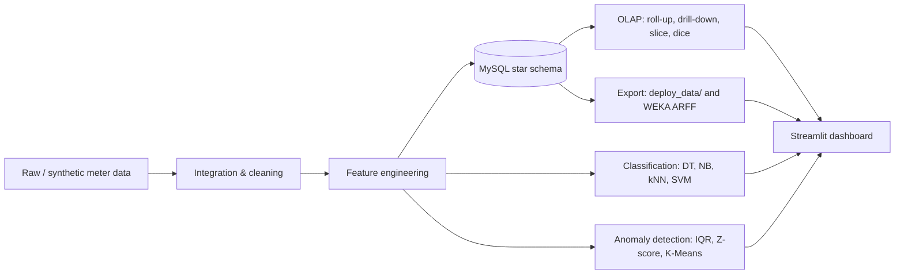
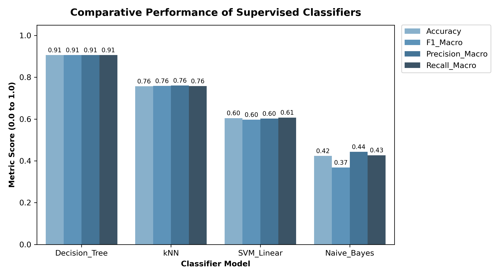
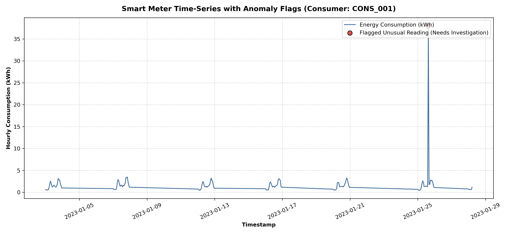
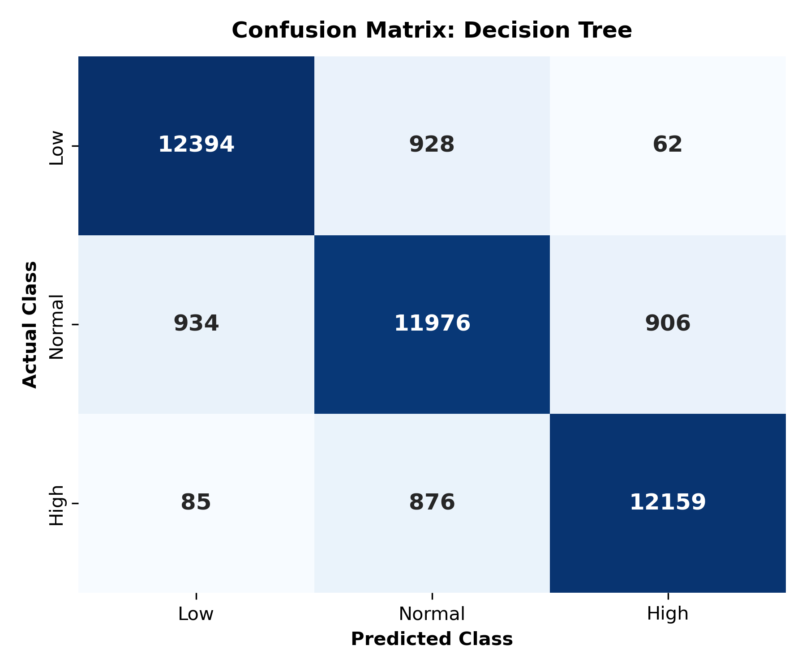
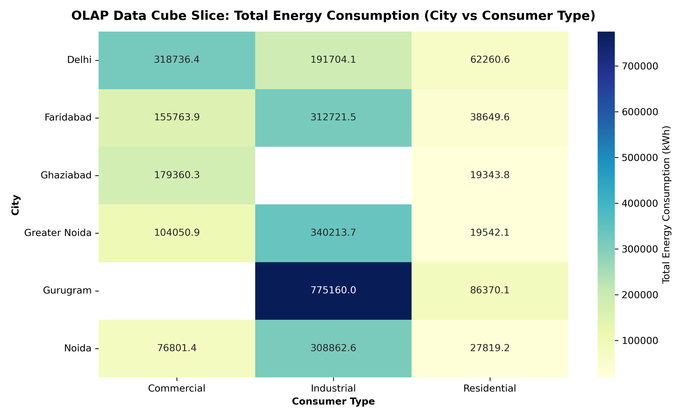

# Smart Energy Consumption Analytics & Anomaly Detection System

An end-to-end analytics platform for electricity consumption data. It cleans raw smart-meter readings, loads them into a star-schema data warehouse, runs OLAP analysis, classifies consumption levels, flags unusual readings, and presents everything in an interactive dashboard.

[](https://www.python.org/)
[](https://streamlit.io/)
[](https://www.mysql.com/)
[](https://scikit-learn.org/)

**Live demo:** (https://smart-energy-analytics-prince.streamlit.app/)

---

## Overview

Utilities and facility managers collect large volumes of meter data, but raw readings alone do not show who uses how much, when, and where, or which readings look wrong. This project turns raw consumption records into answers to those questions:

- How does consumption change by hour, day, month and season, and how does it differ across cities and consumer types?
- Is a given reading low, normal or high for that type of consumer?
- Which readings are unusual enough to be worth investigating?

Flagged readings are treated as **unusual observations that need investigation**. They are not treated as proof of theft or equipment failure.

## Key Features

- **Star-schema data warehouse** in MySQL: one fact table (`Fact_Energy_Consumption`) and five dimensions (`Dim_Date`, `Dim_Time`, `Dim_Consumer`, `Dim_Location`, `Dim_Weather`), with surrogate keys, foreign keys and analytical views.
- **Reproducible 10-step pipeline**: integration, cleaning, feature engineering, warehouse ETL, OLAP, classification, anomaly detection, evaluation, ARFF export, and deployment export. Run it with one command.
- **OLAP operations** (roll-up, drill-down, slice, dice, pivot cube) implemented both in SQL and in Pandas.
- **Four classifiers** (Decision Tree, Naive Bayes, kNN, linear SVM) with hyperparameter tuning, a chronological train/test split, and a leakage-free feature set.
- **Three anomaly detectors** (IQR, Z-score, K-Means distance) computed per consumer, plus a consensus vote across methods.
- **Interactive Streamlit dashboard** with four pages: Overview, OLAP Explorer, Classification, Anomaly Alerts.
- **WEKA export**: ARFF train/test files and a walkthrough for repeating the classification in the WEKA Explorer.
- **Dual-mode data access**: the dashboard reads the live MySQL warehouse when available, and otherwise falls back to an exported copy, so it can be hosted for free without a database server.

## Architecture



**Warehouse grain:** one row per consumer per hour. Dimensions describe the date, time of day, consumer (type, tariff, connected load), location (city, state, region) and weather.

## Results

Evaluated on a chronological hold-out set (the latest 20% of the data).

**Consumption classification (Low / Normal / High)**

| Model | Accuracy | Macro F1 |
|---|---|---|
| Decision Tree | 0.906 | 0.907 |
| kNN | 0.757 | 0.759 |
| Linear SVM | 0.604 | 0.597 |
| Naive Bayes | 0.424 | 0.368 |

The tree-based model fits best because the target depends on non-linear interactions between lagged consumption, time of day and consumer type. Naive Bayes assumes the features are independent, which does not hold for lagged and rolling readings.

**Anomaly detection against injected anomalies**

| Method | Flags | Precision | Recall | F1 |
|---|---|---|---|---|
| IQR (per consumer) | 2,414 | 0.877 | 0.700 | 0.779 |
| Z-score (per consumer) | 1,934 | 0.9995 | 0.639 | 0.780 |
| K-Means distance | 4,032 | 0.188 | 0.250 | 0.214 |
| Consensus (2 or more methods) | 2,043 | 0.961 | 0.650 | 0.775 |

Real labelled anomalies are not available, so 3,024 known consumption surges (about 1.5% of readings) were injected into the data and used as ground truth. Treat these figures as a benchmark of the methods on this dataset, not as a guarantee on real-world data. K-Means is the weakest detector here, and the consensus vote gives high precision without relying on any single method.

## Screenshots

| Model comparison | Anomalies on the time series |
|---|---|
|  |  |

| Decision Tree confusion matrix | OLAP cube heatmap |
|---|---|
|  |  |

Dashboard screenshots: add them under `docs/screenshots/` and link them here.

## Tech Stack

| Layer | Tools |
|---|---|
| Language | Python 3.10+ |
| Data processing | Pandas, NumPy |
| Data mining / ML | scikit-learn, WEKA (ARFF export) |
| Data warehouse | MySQL 8 (SQLAlchemy + PyMySQL), SQLite fallback |
| Visualization | Plotly, Matplotlib, Seaborn |
| Dashboard | Streamlit |
| Packaging / deployment | Docker, Docker Compose, Streamlit Community Cloud |

## Quick Start

```bash
git clone https://github.com/princevarshneyyy/smart-energy-analytics.git
cd smart-energy-analytics

python -m venv venv
source venv/bin/activate          # Windows: venv\Scripts\activate
pip install -r requirements.txt

cp .env.example .env              # Windows: copy .env.example .env
python data/generate_synthetic_data.py
python run_pipeline.py
streamlit run dashboard/app.py
```

MySQL is optional. If it is not reachable, the pipeline uses an embedded SQLite warehouse and the dashboard uses the exported data in `deploy_data/`. To use MySQL, install it, set `DB_HOST`, `DB_USER`, `DB_PASSWORD` and `DB_NAME` in `.env`, then run the scripts in `sql/` or let the pipeline create the schema.

To run everything in containers: `docker compose up --build`.

## Project Structure

```
smart-energy-analytics/
├── config.py                     # central configuration (paths, thresholds, seeds)
├── run_pipeline.py               # runs the full pipeline in order
├── requirements.txt
├── .env.example
├── Dockerfile
├── docker-compose.yml
├── DEPLOYMENT_GUIDE.md
├── data/
│   ├── generate_synthetic_data.py
│   ├── README_data.md
│   └── processed/                # generated datasets and ARFF files
├── sql/                          # schema, OLAP queries, views
├── src/
│   ├── 01_data_integration.py
│   ├── 02_preprocessing.py
│   ├── 03_feature_engineering.py
│   ├── 04_warehouse_etl.py
│   ├── 05_olap_operations.py
│   ├── 06_classification.py
│   ├── 07_anomaly_detection.py
│   ├── 08_model_evaluation.py
│   ├── 09_export_arff.py
│   ├── 10_export_deploy_data.py
│   └── db_connection.py
├── dashboard/
│   ├── app.py
│   ├── utils.py
│   └── pages/                    # Overview, OLAP Explorer, Classification, Anomaly Alerts
├── deploy_data/                  # exported warehouse data for hosting without MySQL
├── weka/WEKA_INSTRUCTIONS.md
├── notebooks/exploration.ipynb
├── outputs/                      # figures, tables, trained models
└── docs/                         # architecture, warehouse design, algorithms, Q&A
```

## Data

The dataset is generated by `data/generate_synthetic_data.py` so that the project is reproducible and has known ground truth for evaluation.

- 50 consumers (28 residential, 15 commercial, 7 industrial) across 6 cities in the Delhi NCR region
- Hourly readings from 2023-01-03 to 2024-12-28, 201,600 records in total
- Daily and seasonal usage patterns, with weather columns (temperature, humidity, condition)
- Deliberately inserted missing values and duplicates for the cleaning stage, and injected consumption surges for anomaly evaluation

The pipeline can also run on real meter data in the same column format, for example a CSV from the [UCI Machine Learning Repository](https://archive.ics.uci.edu/) or [Open Power System Data](https://open-power-system-data.org/). See `data/README_data.md` for the expected columns.

## Method Notes

- **Target definition:** consumption is labelled Low, Normal or High using the 33rd and 67th percentiles within each consumer type, so a residential and an industrial consumer are judged against their own peers.
- **No label leakage:** the classifiers never see the current reading that defines the label. They use only time features, weather, consumer profile, and past (lagged and rolling) consumption.
- **Per-consumer anomaly thresholds:** each consumer's readings are compared with their own history, so a normal industrial load is not flagged because it is larger than a household's.
- **Reproducibility:** fixed random seed, a single configuration file, and an idempotent pipeline.

## Deployment

The dashboard runs in two modes and shows which one is active in the sidebar:

1. **Live MySQL warehouse**, when database credentials are configured and reachable.
2. **Exported warehouse data** from `deploy_data/`, with OLAP aggregations computed in Pandas.

This means it can be hosted for free on Streamlit Community Cloud. See [DEPLOYMENT_GUIDE.md](DEPLOYMENT_GUIDE.md) for the steps.

## Limitations and Future Work

- The data is synthetic, so results show how the methods behave on this data and may not transfer to real meters.
- There are no real labelled anomalies. Detection quality was measured against injected surges only.
- K-Means has low precision on this data. Isolation Forest or seasonal-decomposition-based detectors would be natural additions.
- Processing is batch only. Streaming ingestion and a REST API layer are not included.
- Forecasting of future consumption is not included.

## Academic Context

This project was developed for the Data Mining and Warehousing Lab (course code 24B15CS313) at Jaypee Institute of Information Technology, Noida, Department of CSE.

| Contributor | Enrollment No. |
|---|---|
| Mahima Show | 992401030099 |
| Prince Varshney | 992401030109 |
| Maitry Jain | 992401030406 |

## References

- Han, Kamber, Pei. *Data Mining: Concepts and Techniques.*
- Kimball, Ross. *The Data Warehouse Toolkit.*
- Witten, Frank, Hall, Pal. *Data Mining: Practical Machine Learning Tools and Techniques.*
- [scikit-learn documentation](https://scikit-learn.org/) and [WEKA](https://www.cs.waikato.ac.nz/ml/weka/)
